<!--
  Every image below is generated by scripts/render_cards.py from
  data/contributions.json, which .github/workflows/main.yml refreshes daily.
  Edit the script (content lives at the top of it), not the SVGs.
  Preview the final frame locally with:  STATIC=1 python scripts/render_cards.py
-->

  

  
  
  

  

  
  

  
  

  

